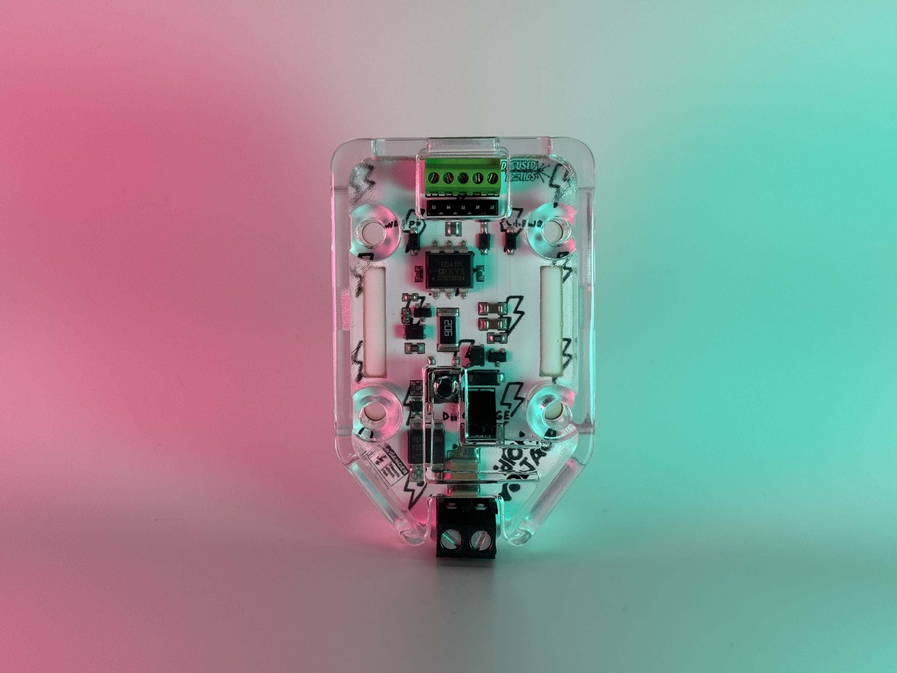

# GlitchCaster

## What

**GlitchCaster** is a modular, XYZ stage-mountable Electromagnetic Fault Injection (EMFI) Evaluation Device based on the open source [PicoEMP](https://github.com/newaetech/chipshouter-picoemp) design. The GlitchCaster generates a roughly 250v EM pulse through either leaded or SMA probe coils, and features the same mounting topology as 40mm fans.

### But what was the PicoEMP?

The PicoEMP was/is a simplified EMFI tool designed by Colin O'Flynn and published under CC-BY-SA-3.0 by NewAE Technologies. In his words, from the PicoEMP Github repo:

> The PicoEMP tries to fill in the gap that ChipSHOUTER leaves at the lower end of the spectrum. This PicoEMP project is *not* the ChipSHOUTER. Instead it's designed to present a "bare bones" tool that has a design optimization focused in rough order of (1) safe operation, (2) cost, (3) usability, (4) performance. Despite the focus on safety and low-cost, it works *suprisingly* well. It is also *not* sold as a complete product - you are responsible for building it, ensuring it meets any relevant safety requirements/certifications, and we completely disclaim all liability for what happens next. Please **only** use PicoEMP where you are building and controlling it yourself, with total understanding of the operation and risks. It is *not* designed to be used in professional or educational environments, where tools are expected to meet safety certifications (ChipSHOUTER was designed for these use-cases).

## Why

For the price-point and ease of access, the [PicoEMP](https://github.com/newaetech/chipshouter-picoemp) and remixes such as ElectronicCats' [FaultyCat](https://github.com/ElectronicCats/faultycat) are great entry-level EMFI tools, but something about holding one of these tools in my hand did not feel right. I got frustrated with trying to 3D print brackets to mount these devices on XYZ staging and designed my own remix with separate control and high voltage boards. This design eventually became the GlitchCaster.

The GlitchCaster maintains the same capability and balance of safety and cost as the open source design which inspired it while addressing several concerns:

- **Mounting:** The GlitchCaster is specifically designed to be mounted on 3D printers or CNC machines for cheap and precise XYZ staging rather than to be operated by hand.
- **Coil Compatibility:** GlitchCasters include a miniature adapter board, supporting _both_ leaded Through-Hole _and_ SMA connector styles of coils.
- **Flexibility of Control:** The GlitchCaster is a PWM-controlled EMF injector based on the design of the PicoEMP separated from the controller section. This allows for the use of controllers other than RP2040s while maintaining backwards compatibility with controllers running firmware for similar remixes and predecessors.

## Hardware

### GlitchCaster

#### Schematic

#### Layout

#### BOM

### SMA Adapter

#### Schematic

#### Layout

### Controller

#### Schematic

#### Layout

#### BOM

### Coil

### Shield

## Controller Firmware

### Changes from PicoEMP firmware

### Flashing

## Buy an assembled GlitchCaster

- [CrowdSupply](https://www.crowdsupply.com/diffused-tactics/glitchcaster)

## Build my own GlitchCaster

## **CAUTION**

Even with cautious operation, the application of EMFI may result in damage to your equipment including the GlitchCaster itself, test targets, XYZ staging, controllers, computers, or other nearby equipment or property.

The GlitchCaster board includes a HIGH VOLTAGE section. The resin shield is absolutely required for safe operation. You can still easily shock yourself on the high-voltage capacitor and circuitry. NEVER operate the device without the shield. Use the built-in button flap on the shield to safely discharge the capacitor for at least 30-seconds and disconnect power before attempting to change or touch the coil. Never connect power without a coil attached. Operation without a coil attached will result in greatly increased risk of electric shock injury and damage to equipment.

**_Diffused Tactics, LLC. holds no responsibility for any unauthorized use of the GlitchCaster or any resulting damages. By purchasing a GlitchCaster you acknowledge and accept that you are responsible for developing it and ensuring sure it complies with any necessary safety standards or certifications. Please only use GlitchCaster if you are developing and managing it yourself, and you completely understand all the hazards, including the potential to damage equipment. It is not intended for use in settings like work or school, where equipment is required to adhere to safety regulations._**

As noted in the original PicoEMP Github:

> With low-side switching the output connector is always "hot", which presents a serious shock hazard.
> 
> PicoEMP gets around this problem by floating the high-voltage side, meaning there is no electrical path between the EMFI probe output and the input voltage ground. With the isolated high voltage output we can use the simple "low-side switching" in a safe manner. Some current will still flow due to the high-frequency spikes, so this isn't *perfect*, but it works well enough in practice (well enough you will shock yourself less often).

## License

This work is licensed under a Creative Commons Attribution-ShareAlike 3.0 International License (cc-by-sa).

cc-by-sa: http://creativecommons.org/licenses/by-sa/3.0/
cc-by-sa-image: https://licensebuttons.net/l/by-sa/3.0/88x31.png
cc-by-sa-shield: https://img.shields.io/badge/License-CC%20BY--SA%203.0-lightgrey.svg

PicoEMP is a trademark of NewAE Technology Inc.

FaultyCat is a trademark of ElectronicCats

NewAE Technology Inc. and PicoEMP are not associated with GlitchCaster or Diffused Tactics, LLC.

Electronic Cats and FaultyCat are not associated with GlitchCaster or Diffused Tactics, LLC.

## tys and greetz

Thank you to Colin O'Flynn, stacksmashing, Lennert Wouters, @nilswiersma for the original PicoEMP hardware and C firmware!

greetz Zenofex and the Exploiteers, Architeuthis Flux, Atredis Partners, JFIO GANG, infosec.exchange bbs, nso.group, haunted.computer, AHA, int80, ytcracker, jippy, dan o, love a brother radio, 972 512 210 469 719 r%
